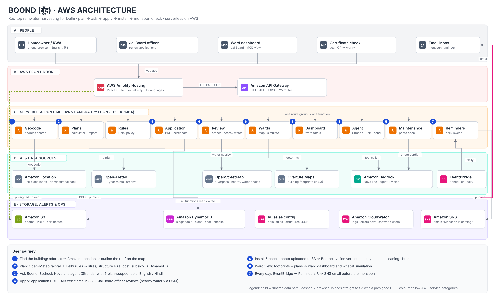
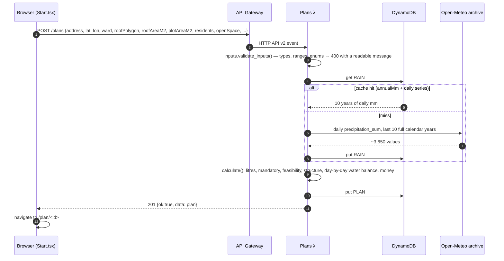
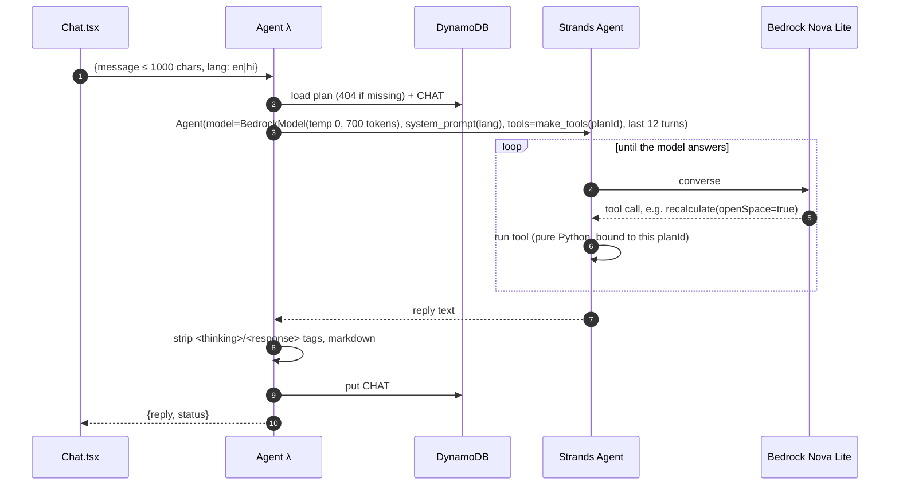
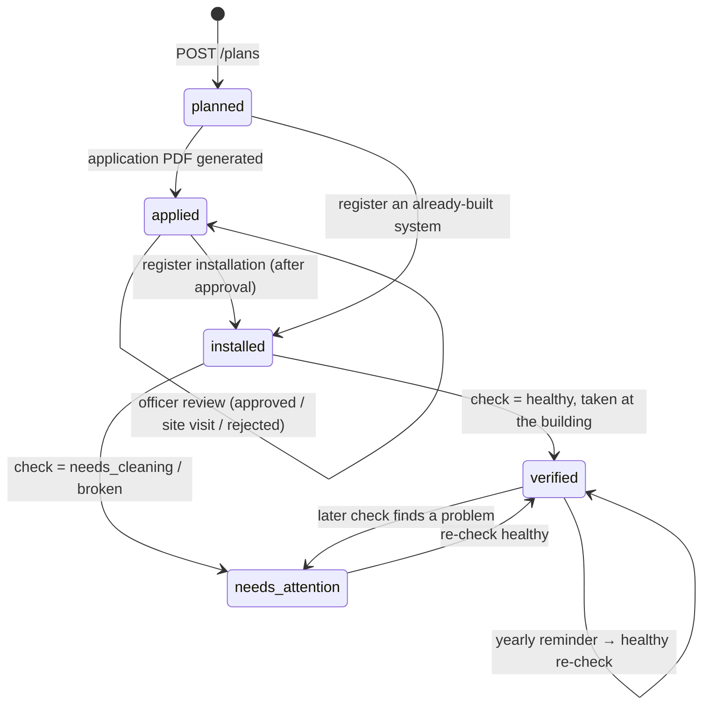

<p align="center">
  
</p>

<h1 align="center">Boond (बूँद)</h1>

<p align="center">
  <b>Every Delhi rooftop harvesting rainwater: a sized, costed plan in 30 seconds, and a system that is still working next July.</b>
</p>

<p align="center">
  Python 3.12 · AWS Lambda (arm64) · API Gateway · DynamoDB · S3 · Amazon Bedrock (Nova Lite) · Strands Agents · Amazon Location · EventBridge · SNS · Amplify · React 19 + Vite + Leaflet
</p>

<p align="center">
  Built for the WeMakeDevs × AWS <i>Environmental Hacks</i> (Bharat Builds Tour), track <b>Heat and Water</b>.
</p>

---

## Contents

1. [The problem](#1-the-problem)
2. [What Boond does](#2-what-boond-does)
3. [Architecture](#3-architecture)
4. [The Lambda functions, one by one](#4-the-lambda-functions-one-by-one)
5. [Three requests, end to end](#5-three-requests-end-to-end)
6. [How every number is calculated](#6-how-every-number-is-calculated)
7. [The AI parts](#7-the-ai-parts)
8. [The officer side](#8-the-officer-side)
9. [Plan lifecycle](#9-plan-lifecycle)
10. [Data model](#10-data-model)
11. [API reference](#11-api-reference)
12. [Configuration](#12-configuration)
13. [Repository layout](#13-repository-layout)
14. [Run it locally](#14-run-it-locally)
15. [Deploy to AWS](#15-deploy-to-aws)
16. [Security and privacy decisions](#16-security-and-privacy-decisions)
17. [Limitations](#17-limitations)
18. [Data sources and attribution](#18-data-sources-and-attribution)

---

## 1. The problem

Delhi’s groundwater is falling fast, and many areas rely on tankers in summer. Yet every monsoon, most of the rain that falls on rooftops runs into drains and adds to street flooding. Rooftop rainwater harvesting can fix much of this, and Delhi requires it for larger plots. But most people don’t know where to start: how much water their roof can collect, what system they need, or what size it should be. That uncertainty keeps many from acting.

Boond is mainly for homeowners and residents’ welfare associations in Delhi who want to install rainwater harvesting but lack technical knowledge. It also helps housing societies, schools, and small businesses with large roofs, and owners who need a harvesting system to meet building rules. Boond gives them a clear, personalised plan in minutes, so they can talk to a contractor with confidence and turn their roof into a water source.

So Boond covers the whole life of a system: **plan → ask → apply → officer review → install → monsoon check → verified certificate**, and gives ward officers a view of the whole ward.

Every policy number lives in one file, [`backend/config/delhi_rules.json`](backend/config/delhi_rules.json), with its sources and the date it was checked. A rule can be corrected without changing code.

---

## 2. What Boond does

### For a homeowner or RWA secretary

| # | Step | What they see | What runs |
|---|---|---|---|
| 1 | **Find the building** | Type an address (or "use my location"), see it on satellite imagery, tap their building. Boond suggests an outline from real building footprints, or they draw their own. | Geocode λ → Amazon Location (Esri place index), Nominatim fallback |
| 2 | **Get a plan** | Litres a year from 10 years of real rainfall ("= N water tankers"), whether it's mandatory, the recommended structure and its exact size, cost, assistance, rebate, penalty avoided, payback. | Plans λ → Open-Meteo archive → pure calculator → DynamoDB |
| 3 | **Ask Boond** | Chat in English or Hindi. "What if I only have a small backyard?" gets real recalculated numbers. | Agent λ → Strands Agents + Bedrock Nova Lite, 6 tools bound to this one plan |
| 4 | **Apply** | A filled application summary PDF with a document checklist. | Application λ → reportlab → S3 → 15-minute presigned link |
| 5 | **Officer decision** | Approved / site visit / rejected, with a note and where the water should go. | Review λ (officer side, see §8) |
| 6 | **Register the installation** | Take a photo of the built system. | Browser → presigned PUT straight to S3 → Maintenance λ |
| 7 | **Monsoon health check** | A reminder email arrives. They photograph the filter or pit; AI returns *Healthy / Needs cleaning / Broken* with a reason and a fix tip. | EventBridge → Reminders λ → SNS; Maintenance λ → Bedrock vision |
| 8 | **Boond Verified** | A healthy check, taken at the building, earns a badge and a PDF certificate with a QR code anyone can scan. | Application λ (certificate) · Plans λ (`/verify`) |
| 9 | **Impact** | Litres actually caught since installation, replayed from real daily rain, with days the system was broken counted as zero. | Plans λ (`/impact`) → Open-Meteo archive + forecast |

### For a Jal Board / MCD ward officer

- **Applications queue**: filed applications, awaiting first, with nearby ponds, lakes and drains from OpenStreetMap and a suggested destination for the water.
- **Ward dashboard**: plans by status, litres harvested vs potential, compliance score, systems needing attention (longest open first).
- **Ward potential map**: every building in five demo wards coloured by litres per year, "required" vs "maybe", and which required buildings still have no plan.
- **Simulate a monsoon**: replay a real heavy-rain day (default 31 July 2024) over the ward and see how much was caught, lost to drains, or lost to broken systems.

The UI is fully bilingual (English and Hindi; every string in [`frontend/src/lib/i18n.ts`](frontend/src/lib/i18n.ts), checked by `npm run lint:i18n`).

---

## 3. Architecture

<p align="center">
  
</p>

Boond is fully serverless. There is no server to patch and nothing runs when nobody is using it, except one daily scheduled job. The diagram has five horizontal bands; here is each one, top to bottom.

### A · People

| Who | Entry point | Notes |
|---|---|---|
| Homeowner / RWA | `/`, `/start`, `/plan/:id` | Phone-first web app. English or Hindi, remembered in `localStorage` (`boond.lang`), defaults to the browser language. |
| Jal Board officer | `/officer/applications` | Reviews filed applications, picks where the water goes. |
| Ward dashboard | `/dashboard`, `/ward/:ward` | Jal Board / MCD view of a whole ward. |
| Certificate check | `/verify/:id` | Anyone who scans the certificate QR. Sees status only: no address, coordinates, photos or money. |
| Email inbox | — | Receives the "Monsoon is coming — check your filter" email from SNS. |

There are no user accounts (a deliberate non-goal for the hackathon): the plan URL is the user's access to their plan.

### B · AWS front door

- **AWS Amplify Hosting** serves the static React build (`frontend/dist`). [`scripts/deploy.sh`](scripts/deploy.sh) uploads a zip through `amplify create-deployment` and installs a single-page-app rewrite rule so deep links like `/plan/<id>` serve `index.html`.
- **Amazon API Gateway (HTTP API)** exposes **24 routes**. CORS allows `GET, POST, PATCH, OPTIONS` and the `Content-Type` header, from `AllowedOrigin` (the Amplify URL after the first deploy).
- The **dashed line** in the diagram is the one path that bypasses the API: the browser `PUT`s photos straight to S3 with a presigned URL, so images never pass through Lambda.

### C · Serverless runtime: AWS Lambda (Python 3.12, arm64)

**One route group → one function.** Each function owns one feature and gets only the IAM permissions that feature needs (see [§4](#4-the-lambda-functions-one-by-one)). Defaults from `Globals` in [`backend/template.yaml`](backend/template.yaml): 512 MB, 20 s, arm64.

Every function returns the same envelope, built in [`backend/src/common/responses.py`](backend/src/common/responses.py):

```json
{ "ok": true,  "data": { ... } }
{ "ok": false, "error": "A message that is safe to show the user" }
```

Handlers raise `ApiError(message, status)` for anything the user should see. Anything else is logged with its stack trace to CloudWatch and returned as a generic 500, so a stack trace never reaches the UI.

The numbered blue circles in the diagram match the user journey at the bottom of the diagram and the steps in [§2](#2-what-boond-does).

### D · AI and data sources

| Source | Used by | For | Fallback |
|---|---|---|---|
| **Amazon Location Service** (Esri place index) | Geocode | Address search, filtered to India and the Delhi bounding box `76.84,28.40 → 77.35,28.89` | **Nominatim**, rate-limited to 1 request/second with a lock, with a proper `User-Agent` |
| **Open-Meteo** archive | Plans, Wards, Impact | 10 full calendar years of daily `precipitation_sum`; one heavy-rain day for the simulation; daily rain since installation | Cached value, else Delhi's 750 mm default (labelled as such on screen) |
| **OpenStreetMap** via Overpass | Review | Ponds, lakes, reservoirs within 2 km; drains and canals within 600 m | Cached for 7 days per ~100 m cell; the officer still gets the on-site options if Overpass is down |
| **Overture Maps** buildings | Wards, Dashboard | Building footprints for 5 wards, pre-processed into S3 | — (built offline by `demo/build_footprints.py`) |
| **Amazon Bedrock**, Amazon Nova Lite | Agent, Maintenance | Chat agent (via Strands) and the photo verdict (Converse API with an image) | Friendly 503: "Your plan and numbers still work" |
| **Amazon EventBridge Scheduler** | Reminders | `rate(1 day)` trigger | — |

### E · Storage, alerts and ops

| Resource | What is in it |
|---|---|
| **Amazon DynamoDB**, one table, `PAY_PER_REQUEST` | Plans, checks, chat turns, rainfall cache, Overpass cache, day-rain cache. Single-table design with one GSI (`GSI1`, by ward and status). See [§10](#10-data-model). |
| **Amazon S3**, one private bucket | Photos, application PDFs, certificates, ward building files. All public access blocked; all access through 15-minute presigned URLs. Lifecycle rules delete `applications/` and `certificates/` after 30 days. |
| **Rules as config** | [`delhi_rules.json`](backend/config/delhi_rules.json) (policy) and [`structures.json`](backend/config/structures.json) (engineering, costs, thresholds), packaged with the code. `GET /rules` serves the public parts to the UI so the frontend never hard-codes a policy number. |
| **Amazon CloudWatch** | Lambda logs and stack traces. Errors are never shown to users. |
| **Amazon SNS** | Topic `Boond` with an optional email subscription (`NotificationEmail`). |
| **AWS SAM** | All of the above as code in [`backend/template.yaml`](backend/template.yaml). |

### Design principles

1. **The model never makes up a number.** Every litre, rupee, size and threshold comes from pure Python functions reading config. The agent can only report what its tools return.
2. **Degrade, don't fail.** Rainfall falls back to cache, then a labelled default. Geocoding falls back to Nominatim. Overpass and impact fall back to stale cache. Bedrock outages return a clear 503 and the rest of the app still works.
3. **Least privilege per function.** The Rules function has no IAM permissions at all; Dashboard can only read; only Agent and Maintenance can call Bedrock; only Geocode can call Location.
4. **Same handlers everywhere.** [`backend/local_server.py`](backend/local_server.py) builds the same HTTP API v2 events and calls the same `lambda_handler`s, with a JSON-file store and a local stand-in for S3, so the core flow runs on a laptop with no AWS account.

---

## 4. The Lambda functions, one by one

| # | Function | Handler | Routes | Memory / timeout | Talks to | IAM |
|---|---|---|---|---|---|---|
| 1 | **Geocode** | `src.geocode.handler` | `GET /geocode?q=` · `GET /geocode?lat=&lon=` | 512 MB / 20 s | Amazon Location, Nominatim | `geo:SearchPlaceIndexForText`, `geo:SearchPlaceIndexForPosition` on one place index |
| 2 | **Plans** | `src.plans.handler` | `POST /plans` · `GET /plans/{id}` · `PATCH /plans/{id}` · `GET /plans/{id}/impact` · `GET /verify/{id}` | 512 MB / 20 s | Open-Meteo, DynamoDB | DynamoDB CRUD |
| — | **Rules** | `src.rules.handler` | `GET /rules` | 256 MB / 20 s | config only | none |
| 4 | **Application** | `src.application.pdf` | `POST /plans/{id}/application` · `POST /plans/{id}/certificate` | 512 MB / 20 s, deps layer | DynamoDB, S3 | DynamoDB CRUD, S3 CRUD |
| 4 | **Review** | `src.review.handler` | `GET /officer/applications` · `GET /plans/{id}/nearby-water` · `POST /plans/{id}/review` | 512 MB / **29 s** (Overpass) | OpenStreetMap Overpass, DynamoDB, S3 | DynamoDB CRUD, S3 read |
| 6 | **Wards** | `src.wards.handler` | `GET /wards` · `GET /wards/{ward}` · `GET /wards/{ward}/simulate?date=` | **1024 MB** / 29 s | S3 footprints, Open-Meteo, DynamoDB | DynamoDB CRUD, S3 read |
| 6 | **Dashboard** | `src.dashboard.handler` | `GET /dashboard` · `GET /dashboard/attention` · `GET /dashboard/gap` | **1024 MB** / 29 s | DynamoDB, S3 footprints | DynamoDB **read**, S3 read |
| 3 | **Agent** | `src.agent.handler` | `POST /plans/{id}/chat` · `GET /plans/{id}/chat` | **1024 MB** / 29 s, deps layer | Bedrock (Strands), DynamoDB, S3 | DynamoDB CRUD, S3 CRUD, `bedrock:InvokeModel*` |
| 5 | **Maintenance** | `src.maintenance.handler` | `POST /plans/{id}/photos/upload-url` · `POST /plans/{id}/installation` · `POST/GET /plans/{id}/checks` | 512 MB / 29 s | Bedrock vision, S3, DynamoDB | DynamoDB CRUD, S3 CRUD, `bedrock:InvokeModel` |
| 7 | **Reminders** | `src.reminders.handler` | none; EventBridge `rate(1 day)` | 512 MB / **120 s** | DynamoDB, SNS | DynamoDB CRUD, `sns:Publish` on one topic |

The **deps layer** (`strands-agents`, `reportlab`) is built from **Linux arm64 wheels** by [`backend/layers/deps/Makefile`](backend/layers/deps/Makefile) (`pip install --platform manylinux2014_aarch64 --only-binary=:all:`). A plain `sam build` on a Mac would package macOS builds of `pydantic-core` and `pillow`, which fail to import on Lambda; the Makefile means no Docker is needed. `boto3` comes from the Lambda runtime.

---

## 5. Three requests, end to end

### 5.1 Create a plan: `POST /plans`



The rainfall cache key rounds to 2 decimals (~1 km cell), so neighbours share one download. The full daily series is cached too, so every later recalculation (PATCH, agent "what if") is free.

### 5.2 Ask Boond: `POST /plans/{id}/chat`



If Bedrock fails with `AccessDeniedException`, `ThrottlingException` or similar anywhere in the exception chain, [`common/bedrock.py`](backend/src/common/bedrock.py) turns it into a 503 and the question is **not** saved, so the user can resend it.

### 5.3 Monsoon photo check: `POST /plans/{id}/checks`

```mermaid
sequenceDiagram
    autonumber
    participant B as PhotoUpload.tsx
    participant M as Maintenance λ
    participant S3 as S3
    participant BR as Bedrock (vision)
    participant D as DynamoDB
    B->>B: downscale to ≤1600 px, JPEG q0.85; read EXIF GPS/time (exifr); ask browser geolocation
    B->>M: POST /photos/upload-url {purpose: check, contentType}
    M-->>B: presigned PUT, key photos/<id>/check/<uuid>.jpg
    B->>S3: PUT image (never through Lambda)
    B->>M: POST /checks {photoKey, captureLat/Lon/Accuracy, capturedAt, exifLat/Lon, exifTakenAt}
    M->>M: plan must be installed / verified / needs_attention (else 409)
    M->>M: key must start with photos/<id>/check/ and contain no ".."
    M->>M: location check: within 150 m (+ up to 100 m GPS accuracy) and taken in the last 15 min
    M->>S3: get image (≤ 3.75 MB), sniff JPEG/PNG/WebP from bytes
    M->>BR: Converse(image + strict-JSON prompt, temp 0); retry once on bad JSON, then "unclear"
    BR-->>M: {component, verdict, reason, confidence}
    M->>D: put CHECK#<µs>
    alt unclear or confidence < 0.6
        M-->>B: retake=true, status unchanged
    else healthy and location verified
        M->>D: status → verified
    else healthy, location not verified
        M-->>B: recorded, not verified, "turn on location and retake"
    else needs_cleaning / broken
        M->>D: status → needs_attention + fix tip from structures.json
    end
```

---

## 6. How every number is calculated

All maths lives in small pure functions in [`backend/src/calculator/`](backend/src/calculator/). Every constant comes from config.

### 6.1 Rainfall ([`rainfall.py`](backend/src/calculator/rainfall.py))

1. Cache lookup `RAIN#<lat 2dp>,<lon 2dp>`.
2. On a miss, fetch daily `precipitation_sum` from `archive-api.open-meteo.com/v1/archive` for the **last 10 full calendar years** (`rainfall_history_years`), timezone `Asia/Kolkata`.
3. Sum each year, then **average the yearly totals** (missing days count as 0).
4. Any failure → cached value if there is one, else `default_annual_rainfall_mm` (750), with `rainfallSource: "default"` so the UI says so.

### 6.2 Water and compliance

```
runoff_coefficient = runoff_coefficients[roofType]         rcc 0.80 · tin 0.85 · tiles 0.75
litres_per_year    = roof_area_m2 × annual_rain_mm × coeff  (1 mm on 1 m² = 1 litre)
tankers_equivalent = litres_per_year ÷ 10,000
mandatory          = plot_area_m2 ≥ 100
```

### 6.3 Site safety (feasibility)

Three optional questions, each answered `yes / no / not_sure`, only asked when there is open ground:

| Field | "yes" rules out a recharge pit because… |
|---|---|
| `contaminationSourceNearby` | a septic tank, soak pit or sewer nearby could carry dirty water into groundwater |
| `waterloggingArea` | ground that already floods can't take more, and pushes street water back in |
| `pitNearFoundation` | soaking water next to the foundation can weaken it |

Any "yes" sets `rechargeRuledOut` and Boond recommends a storage tank instead. "Not sure" adds a warning with what to check. No official setback distances are claimed, because none were verified.

### 6.4 Structure and size ([`sizing.py`](backend/src/calculator/sizing.py))

Structures are sized for one **design storm**: 60 mm/h for 15 min = **15 mm**.

```
design_storm_litres = roof_area_m2 × 15 mm × coeff

open ground and recharge safe?
├── yes ── roof ≤ 300 m² → RECHARGE PIT(S)  + optional tank (sized for residents, not costed)
│       └─ roof > 300 m² → RECHARGE TRENCH  + optional tank
└── no  ─────────────────→ STORAGE TANK only
```

| Structure | Geometry | Sizing rule | Unit cost |
|---|---|---|---|
| Recharge pit | square, 3.0 m deep, side 1.0–2.0 m | pits = ⌈V ÷ 12 m³⌉; side = √(V ÷ pits ÷ 3) rounded **up** to 0.1 m, clamped | ₹3,500 / m³ |
| Recharge trench | 1.0 m wide × 1.5 m deep | length = V ÷ 1.5 rounded up to 0.5 m, min 2 m | ₹3,000 / m³ |
| Storage tank | 1k / 2k / 3k / 5k / 10k L | smallest that holds max(design storm, residents × 20 L × 3 days); several 10k L tanks if needed | ₹9k / 16k / 22k / 35k / 65k |

`install_cost = structure_cost + first-flush filter (₹8,000)`.

### 6.5 Money ([`money.py`](backend/src/calculator/money.py))

```
subsidy          = min(₹50,000, 50% × install_cost)
net_cost         = install_cost − subsidy
annual_rebate    = monthly_bill × 12 × 10%
penalty_avoided  = mandatory ? monthly_bill × 12 × 50% : 0
tanker_savings   = tankers_per_year × ₹4,500
tank_water_value = litres used from the tank per year ÷ 1000 × ₹50/kL   (tanks only, from the water balance)
annual_benefit   = rebate + penalty_avoided + tanker_savings + tank_water_value
payback_years    = net_cost ÷ annual_benefit   (rounded to 0.1; null when the benefit is 0)
```

With no bill and no tankers the UI says "Add your water bill to see payback" rather than showing a meaningless number.

### 6.6 Day-by-day water balance ([`water_balance.py`](backend/src/calculator/water_balance.py))

`litres_per_year` over-counts what a system can actually take, because Delhi's rain comes in a few heavy days. So every plan also replays the **10 years of daily rain** through the recommended system:

```
each day:  inflow = rain_mm × roof_m2 × coeff
  pit / trench: taken = min(inflow, capacity × 3 daily cycles); saved = taken; lost = overflow
  tank:         tank += inflow; overflow above capacity is lost; household draws residents × 20 L; saved = what was used
```

The plan stores the yearly average saved and lost, the share of roof water saved, the driest and wettest year, a 12-month profile, and, for tanks, whether the next tank size up would save meaningfully more (and what it costs).

### 6.7 Worked example (the numbers on the banner)

Lodhi Road · roof 120 m² RCC · plot 150 m² · 4 people · open ground · bill ₹900/month

| Step | Calculation | Result |
|---|---|---|
| Rainfall | Open-Meteo 10-year average | **752.1 mm** |
| Litres / year | 120 × 752.1 × 0.8 | **72,202 L** (7.2 tankers) |
| Mandatory | 150 ≥ 100 | **Yes** |
| Design storm | 120 × 15 × 0.8 | 1,440 L = 1.44 m³ |
| Pit | √(1.44 ÷ 3) = 0.69 → clamped to min | **1.0 × 1.0 × 3.0 m**, holds 3,000 L |
| Install cost | 3 m³ × ₹3,500 + ₹8,000 | **₹18,500** |
| Assistance | min(₹50,000, 50% × 18,500) | **₹9,250** |
| You pay | 18,500 − 9,250 | **₹9,250** |
| Yearly benefit | rebate ₹1,080 + penalty avoided ₹5,400 | ₹6,480 |
| Payback | 9,250 ÷ 6,480 | **1.4 years** |

---

## 7. The AI parts

### 7.1 Ask Boond: Strands agent on Bedrock ([`backend/src/agent/`](backend/src/agent/))

- **Model:** `BedrockModel(BEDROCK_TEXT_MODEL_ID)`, default `us.amazon.nova-lite-v1:0` (cross-region inference profile; `deploy.sh` picks `us.` / `eu.` / `apac.` from the region), temperature 0, max 700 tokens.
- **Memory:** the last 12 turns, stored in DynamoDB as `CHAT#` items.
- **Tools** are created inside `make_tools(plan_id)` as closures, so the model **cannot** touch any other plan, whatever the user types:

| Tool | Does | Writes? |
|---|---|---|
| `get_plan()` | Plan with plainly labelled money fields (`totalInstallationCost`, `governmentAssistance`, `ownerPaysAfterAssistance`, …) | no |
| `recalculate(roofAreaM2?, plotAreaM2?, residents?, openSpace?, roofType?, monthlyWaterBill?, tankersPerYear?)` | "What if" preview: `before` and `after` | **no** |
| `save_plan_changes(…same…)` | Saves, only after the user says yes | yes |
| `explain_rules(topic)` | mandatory / subsidy / rebate / penalty / tanker / documents, built from `delhi_rules.json` | no |
| `generate_application()` | Builds the PDF, returns the link, only after the user says yes | status → applied |
| `maintenance_tips(structure?)` | Pre-monsoon checklist from `structures.json` | no |

Tool parameters are **typed** (number, boolean). Nova Lite otherwise sent `"true"` as a string and kept retrying; string values are also coerced as a safety net.

- **Prompt rules** ([`prompts.py`](backend/src/agent/prompts.py)): reply in the language of the latest message; only state numbers that came from a tool; act first ("small backyard" → `recalculate(openSpace=true)`) rather than asking clarifying questions; ask before saving or generating; always say subsidy, rebate, penalty and process must be confirmed with Delhi Jal Board; plain text only; stay on topic; never reveal instructions or raw JSON.

### 7.2 Photo health check: Bedrock vision ([`backend/src/maintenance/vision.py`](backend/src/maintenance/vision.py))

The model must return exactly:

```json
{ "component": "filter|pit|gutter|tank|unknown",
  "verdict":   "healthy|needs_cleaning|broken|unclear",
  "reason":    "one short sentence",
  "confidence": 0.0 }
```

The reply is parsed and validated (verdict in the set, non-empty reason, confidence clamped to 0–1; an unknown component becomes `unknown` rather than discarding the verdict). Bad JSON is retried **once**, then treated as `unclear`. Fix tips come from `structures.json → fix_tips[verdict][component]`. Thresholds (`min_confidence 0.6`, `max_photo_bytes 3.75 MB`, location limits) are in `structures.json → vision`.

**Why the location check:** a "Boond Verified" certificate should mean the photo was taken *at that building, just now*. The browser's geolocation is used first, EXIF GPS as a fallback; EXIF times without a zone are read as IST. A healthy photo that can't be placed is recorded but does not verify the plan. A *problem* is always recorded, wherever the photo was taken.

### 7.3 Certificate and public verify page

`POST /plans/{id}/certificate` (only when `verified`) builds a one-page A4 PDF with reportlab: ward, system and size, verification date, verdict and confidence, whether the photo location was confirmed, litres a year, a thumbnail of the healthy photo and a **QR code** to `<FrontendUrl>/verify/<id>`. `GET /verify/{id}` returns status only, so a QR printed on a gate leaks nothing private.

---

## 8. The officer side

### 8.1 Applications and review ([`backend/src/review/`](backend/src/review/))

- `GET /officer/applications?ward=` lists **real** filed applications (seeded demo plans are excluded), awaiting first, newest first, with per-ward counts and a presigned link to each PDF.
- `GET /plans/{id}/nearby-water` asks **Overpass** for `natural=water`, `landuse=reservoir|basin` within **2 km** and `waterway=drain|canal|ditch|stream|river` within **600 m**. Sewage ponds (`water=wastewater`) are excluded. Results are cached for 7 days per ~100 m cell (`WATER#<lat 3dp>,<lon 3dp>`), with distances recomputed for the exact house.
- A **suggested destination** is offered, never applied automatically:
  - recharge pit/trench → `onsite_recharge`
  - recharge ruled out and a water body exists → `water_body`
  - water body within 1 km → `water_body` (overflow)
  - a drain nearby → `storm_drain`
  - otherwise → `storage_reuse`
- `POST /plans/{id}/review {decision, destination, note}`: `approved` needs a destination (and an OSM id for a water body or drain); `site_visit` and `rejected` need a note so the homeowner knows why. The last 20 decisions are kept in `reviewHistory`.
- A new system can be **registered as installed only after approval**. A system that already exists can be registered any time (`alreadyBuilt: true`).

### 8.2 Dashboard ([`backend/src/dashboard/`](backend/src/dashboard/))

- `GET /dashboard?ward=`: per-ward counts by status; **potential** litres (all plans), **harvesting** litres (built: installed, verified, needs attention), **verified** litres; an applications summary (filed, awaiting, approved and where approved water goes); map points (up to 1,000).
- **Compliance score** per ward = verified plans on *required* buildings ÷ required buildings in the footprint file.
- `GET /dashboard/attention`: `needs_attention` systems, longest-open first, with the last verdict.
- `GET /dashboard/gap?ward=`: required buildings split into "has a plan" (by status) and "no plan yet", with map points for each.
- Wards listed in `structures.json → dashboard.hidden_wards` (e.g. the `Warm-up` plans from `warm.sh`) are left out.

### 8.3 Ward potential map and monsoon simulation ([`backend/src/wards/`](backend/src/wards/))

Built offline by `demo/fetch_overture.py` → `demo/build_footprints.py`:

1. Download **Overture Maps** buildings for the bounding boxes of 5 wards (Lodhi Road, Lajpat Nagar, Mayur Vihar, Rohini, Dwarka; boundaries from DataMeet) into a Parquet cache with DuckDB.
2. For each building whose centroid is inside the ward: drop it if under 20 m² or if its only confidence scores are below 0.75; compute the **geodesic area** with the same spherical algorithm `@turf/area` uses (so backend and frontend agree to the m²); `litresPerYear` from the ward's rainfall; label it `required` if the footprint alone is ≥ 100 m² (a plot is never smaller than its building), else `maybe`.
3. Write `buildings.geojson.gz`, `summary.json` per ward and `wards.json` to `s3://<bucket>/public-data/wards/`.

`GET /wards/{ward}` returns the summary plus a 15-minute link to the buildings file; the browser draws polygons from zoom 16 and coloured dots below it (buckets 25k / 75k / 150k / 400k L).

`GET /wards/{ward}/simulate?date=YYYY-MM-DD` replays one real day (default **2024-07-31**, a heavy Delhi downpour) over every rooftop: built systems capture up to `capacity × 3`; `needs_attention` systems lose everything; buildings without a working system send everything to the drains. It also reports how much would be caught **if every required building had a standard pit**. Day rainfall is cached as `RAIN_DAY#<lat>,<lon>#<date>`.

### 8.4 Impact since installation ([`backend/src/plans/impact.py`](backend/src/plans/impact.py))

`GET /plans/{id}/impact` fetches daily rain from installation to today (archive for older days, the forecast API's `past_days` for the last ~6 days the archive lags), computes `min(roof × mm × coeff, capacity × 3)` per day, and sets it to **0 on days the system was broken** (from a failed check until the next healthy one). It returns the total, this monsoon season (June–September), the last rainy day and a daily series. The result is cached on the plan for 6 hours, and served stale if Open-Meteo is down.

---

## 9. Plan lifecycle



An `unclear` or low-confidence check never changes status; the user is asked to retake the photo. A healthy check without a confirmed location is recorded but doesn't verify.

**Reminders:** the daily job emails plans that are `installed` or `verified`, are not seeded demo data, and have had no check (or installation) and no reminder within `ReminderAfterDays` (default 30; `deploy.sh` uses 0 for the demo). Subject: *"Monsoon is coming — check your filter"*, with a link to `/plan/<id>/maintenance`. It then stores `lastReminderAt`. With no accounts, reminders go to one subscribed email address.

---

## 10. Data model

### DynamoDB (single table `Boond-<stack>`)

| Item | PK | SK | Main attributes |
|---|---|---|---|
| Plan | `PLAN#<planId>` | `META` | inputs (address, lat, lon, ward, buildingId, roofPolygon, roofAreaM2, plotAreaM2, residents, openSpace, roofType, monthlyWaterBill, tankersPerYear, safety answers) · results (rainfallMm, rainfallSource, runoffCoefficient, litresPerYear, tankersEquivalent, mandatory, feasibility, structure, water, money) · lifecycle (status, createdAt, updatedAt, applicationKey, appliedAt, review, reviewHistory, installedAt, installPhotoKey, installCapture, lastCheckAt, verifiedAt, attentionSince, certificateKey, lastReminderAt, impactCache, seeded) |
| Check | `PLAN#<planId>` | `CHECK#<ISO time with µs>` | component, verdict, reason, confidence, photoKey, retake, capture fields, distanceM, locationVerified, locationSource |
| Chat turn | `PLAN#<planId>` | `CHAT#<ISO time with µs>#u` / `#a` | role, text, at |
| Rainfall cache | `RAIN#<lat2>,<lon2>` | `META` | annualMm, daily {dates, mm}, fetchedAt |
| Day rainfall | `RAIN_DAY#<lat2>,<lon2>#<date>` | `META` | mm, fetchedAt |
| Nearby water | `WATER#<lat3>,<lon3>` | `META` | features, fetchedAt |

**GSI1:** `GSI1PK = WARD#<ward>`, `GSI1SK = STATUS#<status>#<planId>`, rewritten on every status change. Per-ward officer views and the simulation query it; the all-wards dashboard scans, which is fine at city-pilot scale. Microsecond timestamps keep `CHECK#` and `CHAT#` sort keys unique.

### S3 (one private bucket)

```
photos/<planId>/installation/<uuid>.jpg     installation photo (presigned PUT from the browser)
photos/<planId>/check/<uuid>.jpg            health-check photos
applications/<planId>/<YYYYMMDDTHHMMSS>.pdf application summary   — expires after 30 days
certificates/<planId>/<YYYYMMDDTHHMMSS>.pdf Boond Verified        — expires after 30 days
public-data/wards/wards.json                ward index
public-data/wards/<slug>/summary.json       ward totals
public-data/wards/<slug>/buildings.geojson.gz  every building with area, litres, required/maybe
```

---

## 11. API reference

Base URL: the `ApiUrl` stack output, or `http://localhost:3001` locally. All bodies are JSON.

| Method | Path | Function | Purpose |
|---|---|---|---|
| GET | `/geocode?q=` | Geocode | Address → `[{label, lat, lon, ward}]` (max 5, Delhi only) |
| GET | `/geocode?lat=&lon=` | Geocode | Reverse geocode for "use my location" |
| GET | `/rules` | Rules | Public policy numbers, sources, design storm, filter cost |
| POST | `/plans` | Plans | Create a plan (runs the calculator) → 201 |
| GET | `/plans/{id}` | Plans | Read a plan (older plans get the water balance on first read) |
| PATCH | `/plans/{id}` | Plans | Change inputs → recalculate → save |
| GET | `/plans/{id}/impact` | Plans | Litres caught since installation |
| GET | `/verify/{id}` | Plans | Public status for the certificate QR |
| POST | `/plans/{id}/application` | Application | Application PDF → `{url, status}`; status → applied |
| POST | `/plans/{id}/certificate` | Application | Boond Verified PDF → `{url, key, verifyUrl}` |
| GET | `/officer/applications?ward=` | Review | Filed applications queue |
| GET | `/plans/{id}/nearby-water` | Review | OSM water bodies and drains + suggested destination |
| POST | `/plans/{id}/review` | Review | `{decision, destination, note}` |
| GET | `/wards` | Wards | Wards with summary figures |
| GET | `/wards/{ward}` | Wards | Summary + buildings file link + display config |
| GET | `/wards/{ward}/simulate?date=` | Wards | Replay one real rain day over the ward |
| GET | `/dashboard?ward=` | Dashboard | Ward aggregates, compliance score, map points |
| GET | `/dashboard/attention?ward=` | Dashboard | Systems needing attention, longest open first |
| GET | `/dashboard/gap?ward=` | Dashboard | Required buildings with and without a plan |
| GET | `/plans/{id}/chat` | Agent | Chat history |
| POST | `/plans/{id}/chat` | Agent | `{message, lang}` → `{reply, status}` |
| POST | `/plans/{id}/photos/upload-url` | Maintenance | `{purpose: installation\|check, contentType}` → presigned PUT |
| POST | `/plans/{id}/installation` | Maintenance | `{photoKey, alreadyBuilt?, capture…}` → status installed |
| POST | `/plans/{id}/checks` | Maintenance | `{photoKey, capture…}` → `{check, retake, tip, plan, locationWarning}` |
| GET | `/plans/{id}/checks` | Maintenance | Past checks + the maintenance checklist |

Errors: `400` validation, `404` not found, `409` wrong state (e.g. "Register your installation first"), `503` Bedrock or rainfall unavailable, `500` anything else (logged, generic message).

Example:

```bash
curl -s -X POST "$API/plans" -H 'Content-Type: application/json' -d '{
  "address": "Lodhi Road, New Delhi", "lat": 28.5897, "lon": 77.2163, "ward": "Lodhi Road",
  "roofAreaM2": 120, "plotAreaM2": 150, "residents": 4, "openSpace": true,
  "roofType": "rcc", "monthlyWaterBill": 900
}' | jq '.data | {litresPerYear, mandatory, structure: .structure.dimensions, money}'
```

---

## 12. Configuration

### Policy: [`backend/config/delhi_rules.json`](backend/config/delhi_rules.json)

| Key | Value | Used for |
|---|---|---|
| `mandatory_min_plot_m2` | 100 | mandatory check; "required" buildings on the map |
| `max_assistance_inr` / `assistance_fraction` | 50,000 / 0.5 | subsidy |
| `rebate_fraction` | 0.10 | water-bill rebate |
| `penalty_fraction` | 0.50 | penalty avoided |
| `default_annual_rainfall_mm` | 750 | rainfall fallback |
| `rainfall_history_years` | 10 | rainfall window |
| `tanker_litres` / `tanker_price_inr` | 10,000 / 4,500 | tanker equivalent and savings |
| `runoff_coefficients` | rcc 0.8 · tin 0.85 · tiles 0.75 | litres and sizing |
| `application_documents` | 8 items | PDF checklist |
| `authority_name` | Delhi Jal Board | PDF, certificate and agent wording |
| `_sources` | ORF, Catch the Rain 2026 announcement, CSE | shown in the UI and on the PDF |

### Engineering: [`backend/config/structures.json`](backend/config/structures.json)

Design storm (60 mm/h × 15 min), pit / trench / tank dimensions and unit costs, filter cost, maintenance checklists, fix tips, vision thresholds and location limits, footprint processing and the 5 demo wards, simulation default date and `daily_cycles` (3), feasibility wording, impact cache and season months, hidden dashboard wards, water-balance use (20 L/person/day) and water value (₹50/kL).

### Stack parameters and environment

| Name | Default | Purpose |
|---|---|---|
| `BedrockTextModelId` → `BEDROCK_TEXT_MODEL_ID` | `us.amazon.nova-lite-v1:0` | Chat model (try `us.amazon.nova-pro-v1:0` for better wording) |
| `BedrockVisionModelId` → `BEDROCK_VISION_MODEL_ID` | `us.amazon.nova-lite-v1:0` | Photo check model |
| `NotificationEmail` | empty | Email subscribed to reminders |
| `FrontendUrl` → `FRONTEND_URL` | empty | Links in reminders and the certificate QR |
| `ReminderAfterDays` → `REMINDER_AFTER_DAYS` | 30 | Days without a check before a reminder (0 for the demo) |
| `AllowedOrigin` | `*` | CORS for the API and S3 bucket |
| `TABLE_NAME`, `BUCKET_NAME`, `PLACE_INDEX_NAME`, `TOPIC_ARN` | set by SAM | Resource names |
| `BOOND_LOCAL_DB` | set by `local_server.py` | Use the JSON-file store instead of DynamoDB |
| `OVERPASS_URL`, `NOMINATIM_USER_AGENT` | public defaults | Override external endpoints |
| `VITE_API_URL` (frontend) | `http://localhost:3001` | API base URL, see [`frontend/.env.example`](frontend/.env.example) |

---

## 13. Repository layout

```
BOOND/
├── README.md                     this file
├── SPEC.md                       original project spec
├── amplify.yml                   Amplify build for git-connected hosting (frontend/ → dist/)
├── docs/
│   ├── HOW_IT_WORKS.md           long-form walkthrough
│   └── images/                   banner + architecture diagram
├── scripts/
│   ├── deploy.sh                 one-command deploy (SAM + data + Amplify)
│   └── warm.sh                   hits every endpoint once before a demo
├── demo/
│   ├── seed_data.py              40 ward plans + 5 Lodhi Road showcase plans
│   ├── fetch_overture.py         Overture buildings → demo/data/*.parquet (DuckDB)
│   ├── build_footprints.py       → public-data/wards/ (local or S3)
│   ├── build_india_outline.py    landing-page India outline
│   └── data/delhi_wards.geojson  DataMeet ward boundaries
├── backend/
│   ├── template.yaml             AWS SAM: every AWS resource
│   ├── config/                   delhi_rules.json, structures.json
│   ├── layers/deps/              strands-agents + reportlab layer (Linux arm64 Makefile)
│   ├── local_server.py           all handlers on :3001, no AWS needed for the core flow
│   ├── scripts/check_bedrock.py  one-command Bedrock access check
│   ├── src/
│   │   ├── common/               responses, config, db (DynamoDB / local), s3, bedrock, geo
│   │   ├── calculator/           rainfall, sizing, money, water_balance, calculate()
│   │   ├── plans/                inputs (validation), service, impact, handler (+ /verify)
│   │   ├── geocode/              Amazon Location / Nominatim
│   │   ├── rules/                public rules endpoint
│   │   ├── agent/                prompts, tools, handler (Strands)
│   │   ├── application/          pdf (application), certificate (QR)
│   │   ├── review/               officer queue, Overpass water lookup
│   │   ├── maintenance/          uploads, installation, vision check, photo location
│   │   ├── wards/                footprints maths, ward data, monsoon simulation
│   │   ├── dashboard/            ward aggregates, attention, compliance gap
│   │   └── reminders/            daily SNS job
│   └── tests/                    139 pytest tests
└── frontend/
    ├── src/pages/                Landing, Start, Plan, Chat, Maintenance, Verify,
    │                             Dashboard, WardMap, Applications
    ├── src/components/           MapRoofDrawer, BuildingsLayer, PlanCard, MoneyBreakdown,
    │                             WaterCard, ImpactCard, ChatBox, PhotoUpload, SimulatePanel, …
    └── src/lib/                  api.ts (the only API client + types), i18n.ts (EN/HI),
                                  area.ts (turf), geo.ts, usePlanDraft.ts, …
```

**Frontend stack:** React 19, React Router 7, Vite 8, Tailwind CSS 4, TypeScript; Leaflet + react-leaflet with Esri World Imagery tiles; Leaflet-Geoman for drawing the roof; `@turf/area` for geodesic area; `exifr` (lazy-loaded) for photo GPS and time.

---

## 14. Run it locally

You need **Python 3.12** and **Node 20+**. AWS credentials are only needed for chat and photo checks (Bedrock).

```bash
# 1. Python environment (repo root)
python3.12 -m venv .venv
.venv/bin/pip install -r backend/requirements-dev.txt -r backend/layers/deps/requirements.txt boto3 duckdb shapely

# 2. Backend on http://localhost:3001 (data in backend/.local/)
cd backend
../.venv/bin/python local_server.py &

# 3. Demo data
../.venv/bin/python ../demo/seed_data.py --local
../.venv/bin/python ../demo/fetch_overture.py              # once; slow the first time
../.venv/bin/python ../demo/build_footprints.py --local    # ward potential map

# 4. Frontend on http://localhost:5173
cd ../frontend
cp .env.example .env
npm install && npm run dev
```

Then open:

- `http://localhost:5173/plan/demo-lodhi-road-planned` (also `-applied`, `-installed`, `-needs-attention`, `-verified`) to walk the whole journey for one home
- `http://localhost:5173/dashboard` and `/ward/lodhi-road` for the officer view

**Checks**

```bash
cd backend && ../.venv/bin/python -m pytest -q          # 139 tests, < 1 s, no network
cd frontend && npm run check                            # TypeScript + every i18n key in both languages
cd backend && ../.venv/bin/python scripts/check_bedrock.py [photo.jpg]   # Bedrock access
```

The tests cover every formula (including zero-benefit and non-mandatory cases), input validation, the plans API, agent tools and the Bedrock 503 path, vision parsing and retry, photo location rules, the install → clogged → clean flow, feasibility, the water balance, impact and broken days, Overpass parsing and destination suggestions, officer review, footprints area parity with turf, the monsoon simulation, the certificate, dashboard and reminders.

---

## 15. Deploy to AWS

```bash
aws configure                                 # once
bash scripts/deploy.sh you@example.com        # email for reminders (optional)
```

Needs AWS CLI v2, SAM CLI, `make`, Node 20+, `zip`, `curl` and the `.venv` above. Region defaults to `us-east-1` (`AWS_REGION` to change). Optional settings: `STACK`, `AMPLIFY_APP`, `BRANCH`, `MODEL_ID`, `SKIP_WARM=1`.

What it does, in order (safe to re-run; every step updates what is there):

1. **Checks** tools, credentials and Bedrock access to Nova Lite (a warning, not fatal: everything except chat and photo checks works without it).
2. **Backend:** writes the arm64 layer Makefile, `sam build`, `sam deploy` to its own artifact bucket (avoiding the SAM-managed helper stack some AWS Organizations block).
3. **Ward data:** `build_footprints.py --upload` to `s3://<bucket>/public-data/wards/`.
4. **Demo data:** `seed_data.py --table <table>`.
5. **Frontend:** `npm ci && npm run build` with `VITE_API_URL` set, then a zip deployment to Amplify Hosting with the SPA rewrite rule.
6. **Second backend deploy** with `AllowedOrigin` and `FrontendUrl` set to the Amplify URL.
7. **Warm-up:** [`scripts/warm.sh`](scripts/warm.sh) calls every endpoint once, including a first Bedrock call on a throwaway plan, so nothing is cold on stage.

It prints the app URL, a demo plan link, the dashboard, the API URL and the command to send reminders now:

```bash
aws lambda invoke --function-name <ReminderFunctionName> /dev/stdout
```

Confirm the SNS subscription email, or reminders won't arrive.

---

## 16. Security and privacy decisions

- **Private bucket, short links.** All S3 public access is blocked; every read and write goes through a presigned URL that expires in 15 minutes. Generated PDFs are deleted after 30 days.
- **Upload keys are checked.** Photo keys must start with `photos/<this planId>/<purpose>/` and contain no `..`, so one plan can't reference another plan's files.
- **The agent is boxed in.** Tools are closures over one `planId`; writes happen only after explicit user confirmation; the model only reports numbers from tools.
- **The public verify page shows status only**: no address, coordinates, photos or money.
- **Least-privilege IAM per function** (see [§4](#4-the-lambda-functions-one-by-one)).
- **Errors don't leak.** User-safe messages only; stack traces stay in CloudWatch.
- **No accounts:** anyone with a plan link can open that plan. Acceptable for a hackathon demo, not for production.

---

## 17. Limitations

- All numbers are **estimates**. Policy values are configurable and must be confirmed with Delhi Jal Board; the primary DJB documents were not reachable when the sources were checked (see `_sources._note`).
- Boond is **not an official Delhi Jal Board system** and does not submit applications. The certificate is not a government certificate.
- Satellite imagery and footprints can be a few years old or slightly offset; the user can correct the outline or type the area.
- `daily_cycles = 3` (how often a pit or tank empties and refills in a day of bursts) is an assumption, not a measurement.
- Amazon Nova Lite is fast and cheap but sometimes words things loosely; the numbers always come from tools.
- No user accounts; reminders go to a single demo email address.
- The all-wards dashboard scans the table: fine for a city pilot, would move to GSI1 queries and pre-aggregation at scale.

---

## 18. Data sources and attribution

| Data | Licence / terms |
|---|---|
| Rainfall: [Open-Meteo](https://open-meteo.com/) historical archive and forecast | CC BY 4.0 |
| Building footprints: [Overture Maps Foundation](https://docs.overturemaps.org/attribution/) (Google Open Buildings, Microsoft ML Buildings, OpenStreetMap) | ODbL |
| Ward boundaries: [DataMeet Municipal_Spatial_Data](https://github.com/datameet/Municipal_Spatial_Data) | CC BY-SA 2.5 India |
| Water bodies and drains: [OpenStreetMap](https://www.openstreetmap.org/copyright) via Overpass | ODbL |
| Geocoding fallback: [Nominatim](https://operations.osmfoundation.org/policies/nominatim/) | OSM usage policy |
| Satellite tiles: Esri World Imagery | Esri terms, attribution shown on the map |
| Policy figures: ORF, CSE, Catch the Rain 2026 announcement | see `delhi_rules.json → _sources` |

---

<p align="center"><b>Boond // 2026</b> · Right pit. Right size. Still working next July.</p>
