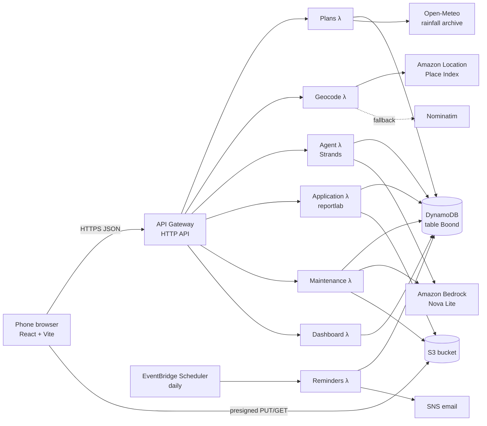
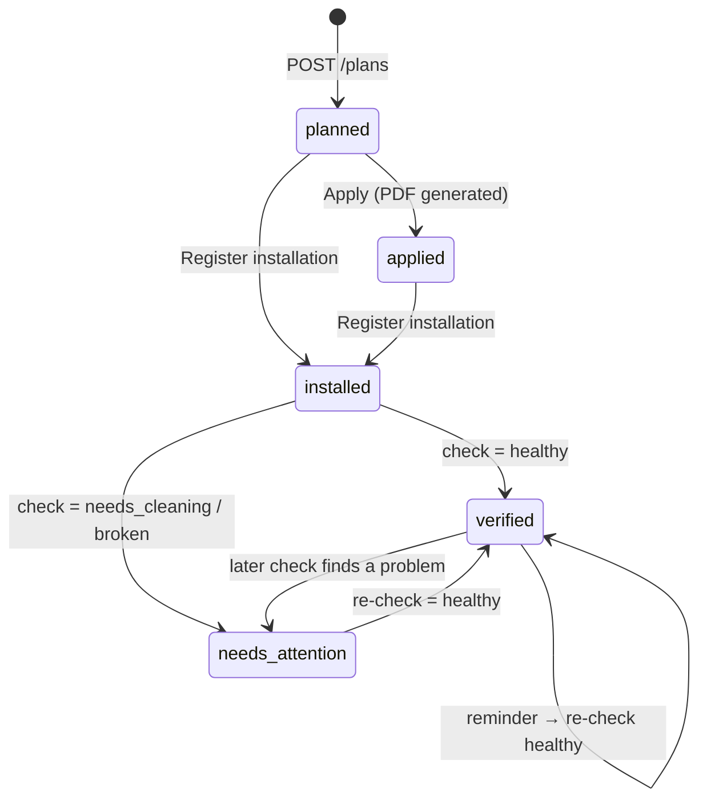

# How Boond works

Boond helps a Delhi homeowner or RWA secretary go from "do I need rainwater harvesting?" to a sized, costed plan, a ready-to-submit application, and a system that is checked every monsoon.

This document walks through the whole workflow: what the user does at each step, which code runs, and how every number is calculated.

---

## 1. The big picture



| Layer | What it is | Where |
|---|---|---|
| Frontend | React + TypeScript + Tailwind, Leaflet map, Geoman drawing, turf area | `frontend/` |
| API | API Gateway HTTP API → one Lambda per feature (Python 3.12, arm64) | `backend/template.yaml` |
| Calculator | Pure Python functions: rainfall, sizing, money | `backend/src/calculator/` |
| AI | Strands Agents SDK + Bedrock (chat), Bedrock Converse with images (photo check) | `backend/src/agent/`, `backend/src/maintenance/` |
| Data | One DynamoDB table plus one S3 bucket (photos and PDFs) | `backend/src/common/` |
| Rules | Every policy number and unit cost lives in two JSON files | `backend/config/` |

Every Lambda returns the same JSON shape: `{ "ok": true, "data": ... }` or `{ "ok": false, "error": "user-safe message" }`. Stack traces go to CloudWatch, never to the UI (`backend/src/common/responses.py`).

---

## 2. Repository map

```
BOOND/
├── SPEC.md                      the original project spec
├── amplify.yml                  Amplify Hosting build (frontend/ → dist/)
├── docs/HOW_IT_WORKS.md         this file
├── demo/
│   ├── seed_data.py             seeds 40 demo plans across 4 wards
│   └── photos/                  your own clean/clogged filter photos for the demo
├── frontend/
│   └── src/
│       ├── main.tsx             app entry: router + i18n provider + CSS
│       ├── App.tsx              header, language toggle, routes
│       ├── pages/
│       │   ├── Home.tsx         address → map → roof → 3 questions
│       │   ├── Plan.tsx         the plan screen + Apply / Ask / Install buttons
│       │   ├── Chat.tsx         "Ask Boond" (EN / हिं)
│       │   ├── Maintenance.tsx  register installation + photo health check
│       │   └── Dashboard.tsx    ward dashboard for Jal Board officers
│       ├── components/
│       │   ├── MapRoofDrawer.tsx  satellite map + roof polygon drawing
│       │   ├── PlanCard.tsx       litres, tankers, mandatory chip, structure
│       │   ├── MoneyBreakdown.tsx cost, subsidy, yearly benefit, payback
│       │   ├── ChatBox.tsx        chat bubbles, suggestions, input
│       │   ├── PhotoUpload.tsx    camera → downscale → presigned upload
│       │   └── Badge.tsx          status pill ("Boond Verified")
│       └── lib/
│           ├── api.ts           the ONLY API client + all TypeScript types
│           ├── area.ts          turf polygon area, ₹ and number formatting
│           └── i18n.ts          every UI string in English and Hindi
└── backend/
    ├── template.yaml            AWS SAM: every AWS resource
    ├── config/
    │   ├── delhi_rules.json     policy: thresholds, subsidy, rebate, penalty, documents
    │   └── structures.json      engineering: design storm, pit/trench/tank sizes, costs, tips
    ├── layers/deps/             Lambda layer: strands-agents + reportlab
    ├── local_server.py          runs all handlers locally on :3001 (no AWS needed for core flow)
    ├── scripts/check_bedrock.py one-command Bedrock access check
    ├── src/
    │   ├── common/              config loader, responses, DynamoDB/local store, S3, Bedrock helpers
    │   ├── calculator/          rainfall.py, sizing.py, money.py, handler.py (calculate)
    │   ├── plans/               inputs.py (validation), service.py (create/get/update), handler.py
    │   ├── geocode/             address search
    │   ├── agent/               prompts.py, tools.py, handler.py (chat)
    │   ├── application/         pdf.py (application summary PDF)
    │   ├── maintenance/         vision.py (photo verdict), handler.py (uploads, install, checks)
    │   ├── reminders/           daily reminder job
    │   └── dashboard/           ward aggregates
    └── tests/                   65 pytest tests
```

---

## 3. The user journey, step by step

### Step 1: Find the building (address search)

**User:** types "12 Lodhi Road" and taps **Search**.

**What happens:**

1. `Home.tsx` calls `api.geocode(q)` → `GET /geocode?q=...`
2. `backend/src/geocode/handler.py`:
   - With `PLACE_INDEX_NAME` set (it is, when deployed), it queries **Amazon Location Service**, limited to India and to a **Delhi bounding box** (`76.84, 28.40` to `77.35, 28.89`).
   - If that fails or isn't configured (local dev), it falls back to **Nominatim**, following its usage policy: at most 1 request per second (enforced with a lock) and a `User-Agent` header.
   - Each result returns `{label, lat, lon, ward}`. The **ward** is taken from the neighbourhood or suburb name. It is what groups plans on the dashboard.
3. If there's exactly one result it is picked automatically; otherwise the user taps one.

### Step 2: Outline the roof (how the map works)

This is `frontend/src/components/MapRoofDrawer.tsx`.

**The map itself**

- A Leaflet `MapContainer` shows **Esri World Imagery** satellite tiles, with the required "Tiles © Esri …" attribution in the corner.
- Before a place is chosen the map shows all of Delhi (zoom 11). Once one is chosen, `FlyTo` animates to it at **zoom 19**, which is roughly individual-rooftop level.
- Esri has real imagery down to zoom 19 (`maxNativeZoom`). The map allows zoom 21 by stretching those tiles, so users can zoom in further to place corners precisely.
- A blue dot marks the geocoded point until a roof is drawn.

**Carving out the roof polygon**

1. The user taps **Draw roof**. This calls Geoman's `map.pm.enableDraw("Polygon")` with self-intersection disabled, so a figure-8 shape isn't allowed.
2. A hint bar says "Tap each corner of your roof…". Each tap adds a vertex, and a dashed line follows the finger or cursor.
3. Tapping the **first corner again** closes the shape. Geoman fires `pm:create`.
4. In `onCreate` the component:
   - removes any previous roof, so there is only ever **one** roof polygon;
   - keeps the new layer and turns on **vertex editing** (`layer.pm.enable()`), so corners can be dragged afterwards and the midpoint handles can add new corners;
   - converts the layer to GeoJSON with `layer.toGeoJSON().geometry`, a standard `Polygon` with `[longitude, latitude]` coordinates.
5. Any later corner drag fires `pm:edit`, which re-emits the updated polygon.
6. **Redraw** clears the polygon and starts again. **Cancel** stops drawing.

**Area calculation**

- `Home.tsx` receives the polygon and calls `polygonAreaM2()` in `lib/area.ts`, which uses `@turf/area`.
- Turf computes the **geodesic area on the Earth's surface** in m², so map projection doesn't distort it. The result is rounded and placed in the editable **Roof area** field.
- The user can overwrite the number (for example, from a building plan). **The typed number is what's used**; the polygon is stored with the plan (`roofPolygon`) for reference but isn't used in the calculation.

### Step 3: Three quick questions

- **Plot area (sq m)**: decides whether harvesting is **mandatory**.
- **People living here**: sizes the storage tank.
- **Open ground (yes/no)**: decides between a **recharge pit or trench** (yes) and a **storage tank only** (no).
- Optional, collapsed: **monthly water bill** (drives rebate, penalty and payback), **tankers per year** (tanker savings), **roof type** (RCC / tin / tiles, which changes the runoff coefficient).

**Get my plan** sends everything to `POST /plans`.

### Step 4: Building the plan (`POST /plans`)

`backend/src/plans/handler.py` → `service.create_plan()`:

1. **Validate** (`plans/inputs.py`): required fields present, numbers within sensible ranges, `openSpace` a real boolean, `roofType` one of the configured types, `roofPolygon` valid GeoJSON. Errors come back as a 400 with a readable message.
2. **Rainfall** (`calculator/rainfall.py`), described in section 4.1.
3. **Calculate** (`calculator/handler.py → calculate()`), described in section 4.
4. **Save** to DynamoDB as `PLAN#<id> / META` with status `planned`, then return the plan.
5. The browser navigates to `/plan/<planId>`. That URL *is* the user's access to their plan; there are no accounts (a spec non-goal).

`PATCH /plans/{id}` re-validates only the changed fields, keeps the stored rainfall unless the location changed, recalculates and saves.

### Step 5: The plan screen

`Plan.tsx` shows:

- **Big number:** litres per year, plus "= N water tankers"
- **Rainfall note:** where the rainfall figure came from
- **Mandatory / not mandatory** chip
- **Recommended structure card:** type, size, capacity per storm, optional tank
- **Money breakdown:** install cost − assistance = you pay; yearly rebate, penalty avoided and tanker savings; **payback in N years**
- **Buttons:** 💬 Ask Boond · 📄 Apply · 🏗️ Register installation (or 🔍 Health check once installed)

### Step 6: Ask Boond (AI chat)

Described in section 5.

### Step 7: Apply (application PDF)

`POST /plans/{id}/application` → `backend/src/application/pdf.py`:

1. Builds an A4 PDF with **reportlab** containing:
   - blank applicant fields to fill in by hand (name, phone, DJB consumer number, signature)
   - property details and whether harvesting is mandatory
   - the proposed system (structure, size, capacity, filter, rainfall, litres per year)
   - cost and assistance, with the rule behind each number
   - the **document checklist** from `delhi_rules.json → application_documents`
   - a disclaimer: estimates only, confirm with Delhi Jal Board, Boond is not an official system
2. Stores it in S3 under `applications/<planId>/<timestamp>.pdf`. Files under this prefix are deleted automatically after 30 days.
3. Returns a **presigned download link** valid for 15 minutes.
4. If the plan was `planned`, its status becomes `applied`.

The agent can also do this from chat, but only after the user confirms.

### Step 8: Register the installation

`Maintenance.tsx`, when the plan is not yet installed:

1. The user taps **Take or choose photo**. On a phone this opens the rear camera (`capture="environment"`).
2. `PhotoUpload.tsx` **downscales the photo in the browser** to at most 1600 px on the long side and converts it to JPEG (quality 0.85). Uploads get faster and stay under Bedrock's image size limit.
3. `POST /plans/{id}/photos/upload-url` returns a **presigned S3 PUT URL** and a key `photos/<planId>/installation/<uuid>.jpg`.
4. The browser uploads straight to S3; the image never passes through Lambda.
5. `POST /plans/{id}/installation {photoKey}` checks that the key belongs to this plan and that the file exists, then sets status **`installed`** and records `installedAt`.

### Step 9: Pre-monsoon health check (AI photo verdict)

Described in section 6.

### Step 10: Reminders

Described in section 7.

### Step 11: Ward dashboard

Described in section 8.

---

## 4. The calculations

All maths is in small pure functions in `backend/src/calculator/`. Every policy number and cost comes from config, so changing a rule never needs a code change.

### 4.1 Rainfall (`rainfall.py`)

1. **Cache first:** the key is the location rounded to 2 decimals (`RAIN#28.59,77.22`, roughly a 1 km cell). On a hit, the cached value is used (`rainfallSource: "cache"`).
2. **Otherwise Open-Meteo:** fetch daily `precipitation_sum` from `archive-api.open-meteo.com/v1/archive` for the **last 10 full calendar years** (for example 2016-01-01 to 2025-12-31).
3. Sum the daily values within each year, then **average the yearly totals** (missing days count as 0).
4. Save the result to the cache (`rainfallSource: "open-meteo"`).
5. **If anything fails**, use `default_annual_rainfall_mm` from config (750 mm) and mark `rainfallSource: "default"`. The plan page then says "Based on Delhi's typical 750 mm…".

### 4.2 Water harvested

```
runoff_coefficient = rules.runoff_coefficients[roofType]     rcc 0.8 · tin 0.85 · tiles 0.75
litres_per_year    = roof_area_m2 × annual_rainfall_mm × runoff_coefficient
tankers_equivalent = litres_per_year / rules.tanker_litres   (10,000 L)
```

(1 mm of rain on 1 m² = 1 litre.)

### 4.3 Is it mandatory?

```
mandatory = plot_area_m2 >= rules.mandatory_min_plot_m2      (100 m²)
```

### 4.4 Which structure, and how big (`sizing.py`)

Structures are sized for one **design storm**, the burst of rain the system must take in at once:

```
design_storm_mm     = design_rainfall_mm_per_hour × design_storm_minutes / 60      60 mm/h × 15 min = 15 mm
design_storm_litres = roof_area_m2 × design_storm_mm × runoff_coefficient
```

**Decision tree**

```
open ground?
├── yes ─ roof ≤ 300 m² ? ── yes → RECHARGE PIT(S)   + optional storage tank
│                          └─ no  → RECHARGE TRENCH  + optional storage tank
└── no ─────────────────────────→ STORAGE TANK only
```

**Recharge pit:** square, fixed depth 3 m

- Volume needed V = design storm litres ÷ 1000 (m³)
- Number of pits = ⌈V ÷ (max_side² × depth)⌉, with max side 2 m (so at most 12 m³ per pit)
- Side = √(V ÷ count ÷ depth), rounded **up** to 0.1 m, then kept between 1.0 m and 2.0 m
- Capacity = side² × depth × count; cost = capacity (m³) × ₹3,500/m³

**Recharge trench:** 1 m wide, 1.5 m deep

- Length = V ÷ (1 × 1.5), rounded up to 0.5 m, minimum 2 m; cost = volume × ₹3,000/m³

**Storage tank:** standard sizes 1,000 / 2,000 / 3,000 / 5,000 / 10,000 L with fixed prices

- Needed = the larger of (design storm litres) and (residents × 20 L/day × 3 days)
- Pick the smallest standard tank that fits; if even 10,000 L is too small, use several 10,000 L tanks
- The **optional tank** shown with a pit or trench is sized from residents only and is *not* included in the cost

**Install cost** = structure cost + first-flush filter (₹8,000).

### 4.5 Money (`money.py`)

```
subsidy          = min(max_assistance_inr, install_cost × assistance_fraction)   min(₹50,000, 50%)
net_cost         = install_cost − subsidy
annual_rebate    = monthly_water_bill × 12 × rebate_fraction                     10%
penalty_avoided  = mandatory ? monthly_water_bill × 12 × penalty_fraction : 0    50%
tanker_savings   = tankers_per_year × tanker_price_inr                           ₹4,500
annual_benefit   = annual_rebate + penalty_avoided + tanker_savings
payback_years    = net_cost / annual_benefit  (rounded to 0.1; null when benefit is 0)
```

With no water bill and no tankers the benefit is 0, so the UI says "Add your water bill to see payback" instead of showing a number.

### 4.6 Worked example (the one in the screenshots)

Lodhi Road · roof 120 m² (RCC) · plot 150 m² · 4 people · open ground yes · bill ₹900/month

| Step | Calculation | Result |
|---|---|---|
| Rainfall | Open-Meteo 10-year average | 752.1 mm |
| Litres/year | 120 × 752.1 × 0.8 | **72,202 L** |
| Tankers | 72,202 ÷ 10,000 | **7.2** |
| Mandatory | 150 ≥ 100 | **Yes** |
| Design storm | 120 × 15 mm × 0.8 | 1,440 L = 1.44 m³ |
| Pit side | √(1.44 ÷ 3) = 0.69 → minimum | **1.0 × 1.0 × 3.0 m**, holds 3,000 L |
| Install cost | 3 m³ × ₹3,500 + ₹8,000 filter | **₹18,500** |
| Assistance | min(₹50,000, 50% × 18,500) | **₹9,250** |
| You pay | 18,500 − 9,250 | **₹9,250** |
| Rebate | 900 × 12 × 10% | ₹1,080 / yr |
| Penalty avoided | 900 × 12 × 50% | ₹5,400 / yr |
| Payback | 9,250 ÷ 6,480 | **1.4 years** |

---

## 5. Ask Boond: the AI agent

Files: `backend/src/agent/handler.py`, `tools.py`, `prompts.py`.

### Request flow

```
Chat.tsx ── POST /plans/{id}/chat {message, lang} ──► handler.py
   1. check the plan exists (404 otherwise)
   2. validate the message (non-empty, ≤ 1000 characters)
   3. load chat history (PLAN#id / CHAT#… items) → last 12 turns as Bedrock messages
   4. build a Strands Agent:
        model  = BedrockModel(BEDROCK_TEXT_MODEL_ID, temperature 0, max 700 tokens)
        prompt = system_prompt(lang)
        tools  = make_tools(planId)      ← tools are tied to THIS plan only
   5. agent(message): the model may call tools several times, then writes a reply
   6. clean the reply (remove <thinking>/<response> tags and markdown links/bold)
   7. save the user message and the reply to DynamoDB, return {reply, status}
```

### The tools

Each tool is created inside `make_tools(plan_id)`, so the model **cannot** read or change any other plan, even if a user tries to trick it.

| Tool | What it does | Saves? |
|---|---|---|
| `get_plan()` | Returns the plan with clearly labelled money fields (`totalInstallationCost`, `governmentAssistance`, `ownerPaysAfterAssistance`, …) | No |
| `recalculate(roofAreaM2?, plotAreaM2?, residents?, openSpace?, roofType?, monthlyWaterBill?, tankersPerYear?)` | "What if" preview: returns `before` and `after` | **No** |
| `save_plan_changes(...same fields)` | Writes the change (only after the user says yes) | Yes |
| `explain_rules(topic)` | Rules for mandatory / subsidy / rebate / penalty / tanker / documents, with plain-language text built from `delhi_rules.json` | No |
| `generate_application()` | Builds the PDF and returns the link (only after the user says yes) | Status → applied |
| `maintenance_tips(structure?)` | The pre-monsoon checklist from `structures.json` | No |

The tool parameters are **typed** (number, boolean) rather than a free-form dictionary. Nova Lite otherwise sent `"true"` as text and kept retrying. Text values like `"true"` or `"120"` are also converted, as a safety net.

### Prompt rules (`prompts.py`)

- Reply in the language of the user's **latest** message (Hindi in Devanagari, or English); short and practical.
- **Only state numbers that come from a tool.** Never invent subsidy amounts or rules.
- Act first: for "what if…" questions, call `recalculate` straight away with a sensible assumption instead of asking a clarifying question. For example, "small backyard" → `openSpace=true`.
- Ask before saving changes or generating the application.
- Always say subsidy, rebate, penalty and process must be confirmed with Delhi Jal Board.
- Plain text only; links pasted as bare URLs.

### When Bedrock is unavailable

`common/bedrock.py` looks for AWS error codes such as `AccessDeniedException` or `ThrottlingException` anywhere in the exception chain and turns them into a **503** with:

> Boond's AI assistant isn't available right now. Your plan and numbers still work — please try again in a few minutes.

The question is **not** saved, so the user can resend it. Unrelated bugs are not hidden behind this message; they still return a 500 and are logged.

---

## 6. Pre-monsoon health check: the AI photo verdict

Files: `backend/src/maintenance/vision.py`, `handler.py`.

```
PhotoUpload ─► upload-url ─► PUT to S3 ─► POST /plans/{id}/checks {photoKey}
                                                 │
   1. plan must be installed / verified / needs_attention (else 409 "Register your installation first")
   2. photoKey must start with photos/<planId>/check/
   3. read the image from S3 (max 3.75 MB) and detect JPEG/PNG/WebP from its bytes
   4. Bedrock Converse (BEDROCK_VISION_MODEL_ID, temperature 0) with the image + strict-JSON prompt
   5. parse and validate the JSON; on failure retry ONCE; still bad → "unclear"
   6. decide:
        unclear OR confidence < 0.6 → retake = true, status unchanged
        healthy                      → status verified  (Boond Verified badge)
        needs_cleaning / broken      → status needs_attention + fix tip
   7. save CHECK#<timestamp> item, return {check, retake, tip, plan}
```

**What the model must return:**

```json
{"component": "filter|pit|gutter|tank|unknown",
 "verdict": "healthy|needs_cleaning|broken|unclear",
 "reason": "one short sentence",
 "confidence": 0.0-1.0}
```

**Validation:** the verdict must be one of the four values, the reason must be non-empty and the confidence must be a number (limited to 0–1). An unrecognised component becomes `unknown` rather than throwing away the verdict.

**Fix tips** come from `structures.json → fix_tips[verdict][component]`, for example "Clear leaves and debris from the gutter and downpipe so rain reaches the filter."

The thresholds (`min_confidence: 0.6`, `max_photo_bytes`) are in `structures.json → vision`.

Tested on real photos: clogged gutter → *Needs cleaning (0.9)*; clean downpipe → *Healthy (0.9)*; restaurant photo → *Unclear*.

---

## 7. Reminders

`backend/src/reminders/handler.py`, run **daily** by EventBridge Scheduler.

A plan gets a reminder when **all** of these are true:

- status is `installed` or `verified`
- it is **not** seeded demo data (`seeded: true` plans are skipped)
- its last activity (last check, or else installation, or else creation) was at least `REMINDER_AFTER_DAYS` ago
- it hasn't had a reminder within that same window

For each such plan it publishes to the SNS topic, with subject **"Monsoon is coming — check your filter"** and a link to `<FrontendUrl>/plan/<id>/maintenance`. It then stores `lastReminderAt` so the same plan isn't emailed again.

For the demo, deploy with `ReminderAfterDays=0` and run the function by hand:

```
aws lambda invoke --function-name <ReminderFunctionName output> out.json
```

There are no user accounts, so reminders go to a single demo email address that is subscribed to the topic.

---

## 8. Ward dashboard

`GET /dashboard?ward=` → `backend/src/dashboard/handler.py` → `Dashboard.tsx`.

- Reads all plans (`SK = META`) and groups them by `ward`.
- For each ward it returns counts per status, **potential** litres (all plans), **harvesting** litres (built systems: installed, verified, needs attention) and **verified** litres.
- With `?ward=` it also returns map points for that ward; without it, for all wards.

**On screen:**

- Ward chips
- Hero figure: litres a year captured by systems already built
- 4 stat tiles: Plans · Built · Boond Verified · Need attention
- A bar of where every plan stands, with a legend that always shows icon, label and count
- A light-gray Esri map with one dot per plan; tap a dot to open the plan
- A ward comparison table

Status colours are fixed per status and were checked for colour-blind separation. Colour is never the only signal: each colour comes with an icon and a label.

**Demo data:** `python demo/seed_data.py --local` (or `--table <name>` for AWS) creates 40 plans: 10 each in Dwarka, Rohini, Mayur Vihar and Lajpat Nagar. It uses real Open-Meteo rainfall for each ward and a fixed random seed. IDs are `demo-<ward>-NN`, so re-running overwrites instead of duplicating.

---

## 9. Plan status lifecycle



An `unclear` or low-confidence check never changes the status; the user is asked to retake the photo.

---

## 10. Data model (DynamoDB single table)

| Item | PK | SK | Main attributes |
|---|---|---|---|
| Plan | `PLAN#<planId>` | `META` | address, lat, lon, ward, roofPolygon, roofAreaM2, plotAreaM2, residents, openSpace, roofType, monthlyWaterBill, tankersPerYear, rainfallMm, rainfallSource, litresPerYear, tankersEquivalent, mandatory, structure{…}, money{…}, status, createdAt, updatedAt, installedAt?, lastCheckAt?, lastReminderAt?, applicationKey?, seeded? |
| Check | `PLAN#<planId>` | `CHECK#<iso time, µs>` | component, verdict, reason, confidence, photoKey, retake |
| Chat | `PLAN#<planId>` | `CHAT#<iso time, µs>#u/a` | role, text, at |
| Rainfall cache | `RAIN#<lat2>,<lon2>` | `META` | annualMm, fetchedAt |

**GSI1:** `GSI1PK = WARD#<ward>`, `GSI1SK = STATUS#<status>#<planId>`. It is updated whenever a status changes. The dashboard currently scans the table, which is fine at demo scale; GSI1 is there for per-ward queries at larger scale.

**S3 keys:** `photos/<planId>/installation|check/<uuid>.jpg`, `applications/<planId>/<time>.pdf`. The bucket is private; all access is through 15-minute presigned URLs.

---

## 11. API reference

| Method | Path | Lambda | Purpose |
|---|---|---|---|
| GET | `/geocode?q=` | Geocode | Address → `[{label, lat, lon, ward}]` |
| POST | `/plans` | Plans | Create a plan (runs the calculator) |
| GET | `/plans/{id}` | Plans | Read a plan |
| PATCH | `/plans/{id}` | Plans | Change inputs → recalculate → save |
| GET / POST | `/plans/{id}/chat` | Agent | Chat history / ask Boond `{message, lang}` |
| POST | `/plans/{id}/application` | Application | Generate the PDF → `{url, status}` |
| POST | `/plans/{id}/photos/upload-url` | Maintenance | `{purpose, contentType}` → presigned PUT |
| POST | `/plans/{id}/installation` | Maintenance | `{photoKey}` → status installed |
| POST / GET | `/plans/{id}/checks` | Maintenance | Run a photo check / list checks and the checklist |
| GET | `/dashboard?ward=` | Dashboard | Ward aggregates and map points |

---

## 12. Configuration: what to edit

**`backend/config/delhi_rules.json`** is policy and must be verified against the official notification:

| Key | Value | Used for |
|---|---|---|
| `mandatory_min_plot_m2` | 100 | mandatory check |
| `max_assistance_inr` / `assistance_fraction` | 50000 / 0.5 | subsidy |
| `rebate_fraction` | 0.10 | water-bill rebate |
| `penalty_fraction` | 0.50 | penalty avoided |
| `default_annual_rainfall_mm` | 750 | rainfall fallback |
| `tanker_litres` / `tanker_price_inr` | 10000 / 4500 | tanker equivalent and savings |
| `runoff_coefficients` | rcc 0.8, tin 0.85, tiles 0.75 | litres per year, sizing |
| `application_documents` | list | PDF checklist |
| `authority_name` | Delhi Jal Board | PDF and agent wording |

**`backend/config/structures.json`** holds the engineering numbers and costs: design storm (60 mm/h for 15 min), pit, trench and tank dimensions and unit costs, filter cost, maintenance checklists, fix tips, and the vision thresholds.

**Environment and SAM parameters**

| Name | Default | Purpose |
|---|---|---|
| `BEDROCK_TEXT_MODEL_ID` / `BedrockTextModelId` | `us.amazon.nova-lite-v1:0` | chat model (try `us.amazon.nova-pro-v1:0` for better wording) |
| `BEDROCK_VISION_MODEL_ID` / `BedrockVisionModelId` | `us.amazon.nova-lite-v1:0` | photo check model |
| `NotificationEmail` | empty | email subscribed to reminders |
| `FrontendUrl` | empty | link inside reminder emails |
| `ReminderAfterDays` | 30 | use 0 for the demo |
| `AllowedOrigin` | `*` | CORS; set to the Amplify URL after deploy |
| `VITE_API_URL` (frontend) | `http://localhost:3001` | API base URL |

---

## 13. Running, testing, deploying

**Local, no AWS needed for the core flow**

```bash
# backend (Python 3.12 venv at repo root)
cd backend
../.venv/bin/python local_server.py          # http://localhost:3001, data in backend/.local/
../.venv/bin/python ../demo/seed_data.py --local

# frontend
cd frontend && npm install && npm run dev     # http://localhost:5173
```

`local_server.py` builds the same events API Gateway would and calls the same Lambda handlers. It stores data in a JSON file and stands in for S3 at `/_files/...`. Chat and photo checks still call real Bedrock with your local AWS credentials.

**Tests:** `cd backend && ../.venv/bin/python -m pytest -q` (65 tests: every formula including zero-benefit and non-mandatory cases, validation, the plan API, agent tools and the 503 path, vision parsing and retry, the full install → clogged → clean flow, dashboard and reminders).

**Check Bedrock access:** `../.venv/bin/python scripts/check_bedrock.py [photo.jpg]`

**Deploy the backend**

```bash
cd backend
PATH="../.venv/bin:$PATH" sam build --no-use-container
sam deploy --stack-name boond --region us-east-1 --resolve-s3 --capabilities CAPABILITY_IAM \
  --parameter-overrides NotificationEmail=<you@example.com> ReminderAfterDays=0
```

**Deploy the frontend:** push to GitHub, connect the repo in Amplify Hosting (`amplify.yml` is included) and set `VITE_API_URL` to the stack's `ApiUrl` output. Add a single-page-app rewrite so `/plan/<id>` doesn't return 404. Then redeploy the backend with `FrontendUrl` and `AllowedOrigin` set to the Amplify URL.

---

## 14. Status and limitations

| Milestone | State |
|---|---|
| M1 Calculator core | ✅ done |
| M2 Map + plan UI | ✅ done |
| M3 Deploy | ⏳ `sam build` passes; `sam deploy` and Amplify not run yet |
| M4 Agent + PDF | ✅ done, tested with real Bedrock (EN + HI) |
| M5 Maintenance check | ✅ done, tested with real Bedrock; needs your own demo photos |
| M6 Reminders + dashboard + seed | ✅ done |
| M7 Auto roof outline | stretch, not started |
| M8 README, diagram, video | not started |

**Limitations to state in the README and video:**

- All numbers are **estimates**. Policy values are configurable and must be confirmed with Delhi Jal Board.
- Boond is **not an official Jal Board system** and does not submit applications.
- The roof outline is drawn by hand; satellite imagery can be a few years old or slightly offset.
- No user accounts: anyone with a plan link can open that plan.
- Nova Lite is fast and cheap but occasionally words things loosely; the numbers always come from tools.
